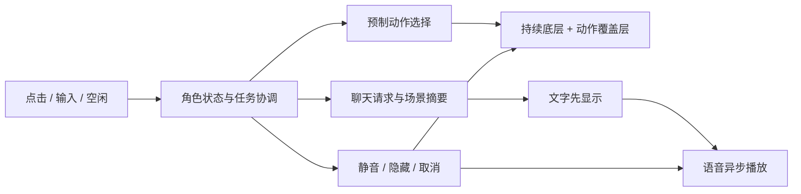

> 历史/专题资料（2026-10-30 已统一）：当前方向、主线、状态与任务以 [统一项目中心](docs/project/README.md) 为准。下文保留原阶段记录，其中数量、运行入口和完成结论需按现状复核。

# 马尔福桌宠：原版、当前接入与下一步

检查日期：2026-10-29。依据本地 DMG 内原始代码、`MALFOY-ENGINE` 改版和 `Sources/PetDesk`。
本次研究没有调用 Agnes、edge-tts 或其他外部模型，没有读取个人密钥文件。

## 结论

**这套方案适合继续验证桌面陪伴体验。它已经用预制内容解决了“角色一直在场”的问题，下一步应让聊天、声音与画面服从同一个状态。**

原版通过预制视频、场景、剧情选择和好感解锁形成体验；当前新增 AI 层能聊天并配音，还未控制实时口型或根据语义选择角色动作。
如果主要目标是 Mac 常驻小窗，建议以 PetDesk 为体验主线，保留 Electron 版作原版对照和素材预览入口。
若要主打沉浸全屏剧情，Electron 版保留的场景、相册、剧情系统更完整。暂时没有必要维护三套独立聊天链路。

## 1. 目前实际上有三种实现

| 实现 | 已有机制 | 尚未连接的部分 |
|---|---|---|
| DMG 原版 Miss Malfoy | Electron 桌面壁纸窗/互动窗；预制动作；分支剧情、相册、场景与好感度 | 对比原始 `main.js` 和 `web/app.js`，没有当前改版新增的 LLM/TTS 聊天实现 |
| `MALFOY-ENGINE` | 保留原版播放/内容系统；新增 Agnes 聊天、edge-tts、聊天气泡 | 场景/睡眠/关系状态未送入模型；AI 配音未驱动嘴部；聊天记录未持久化 |
| `PetDesk` | 原生 AppKit 浮动小窗；拖动、单击、双击输入；双层 AVPlayer；共享模型设置和本地聊天文件 | 没接入原版剧情/好感/相册；回复没有口型；状态恢复和任务取消仍有缺口 |

PetDesk 的共享模型客户端现在同时支持本地端点与远程网关，不能把它一概称为离线应用。
Electron 接入则写定了远程 Agnes 地址、代理端口和一条本机 edge-tts 可执行文件路径。

来源：[Electron 主进程](/Users/exasdwyh/Documents/VScode/vidu/desktop-companion/MALFOY-ENGINE/main.js:9)、[聊天 UI](/Users/exasdwyh/Documents/VScode/vidu/desktop-companion/MALFOY-ENGINE/web/app.js:575)、[PetDesk 控制器](/Users/exasdwyh/Documents/VScode/vidu/desktop-companion/Sources/PetDesk/PetController.swift:194)、[共享模型客户端](/Users/exasdwyh/Documents/VScode/vidu/desktop-companion/Sources/CompanionCore/LocalModel.swift:13)。

## 2. 最值得借鉴的机制

### 角色与空间是一起制作的

沙发、壁炉、服装、姿态和环境动态形成同一个场景。运行时播放已生成的视频，不要求每次互动都重新生成一段画面。
这能降低日常交互的生成成本；代价是动作范围由素材库决定，重复率需要通过素材和调度管理。

它也是完整矩形场景。PetDesk 把这个场景缩成浮动小窗，目前没有实现透明人物抠像、桌面行走或跨窗口攀爬。

### 持续播放的环境底层 + 一次性动作层

原版有两个环境 video 和两个动作 video，通过交替播放及淡入淡出交接。参数是环境交叉淡化 0.6 秒、动作退出 0.45 秒。
PetDesk 已采用持续待机底层与动作覆盖层，并实现提前退出动作。这里的“锚点”应按状态设计：清醒、睡眠分别有对应底层，不能把所有片段都接回清醒坐姿。

来源：[原版衍生播放器](/Users/exasdwyh/Documents/VScode/vidu/desktop-companion/MALFOY-ENGINE/web/app.js:102)、[PetDesk 播放器](/Users/exasdwyh/Documents/VScode/vidu/desktop-companion/Sources/PetDesk/Stage.swift:46)。

### 角色数据与引擎分开

`data.js` 已集中描述场景、素材地址、点击区域、剧情流、字幕时间、解锁阈值和称呼。
接新角色时，值得保留这种组织方式。后续最好采用受校验的 JSON 清单，使角色包包含人格、场景、动作和声音配置。

### 回访有内容结果

原版用每日访问、触摸冷却、剧情选择增加好感，解锁照片和场景。这提供了回访目标。
它目前是内容解锁数值，不等于 AI 理解了关系，也没有证明长期留存。新角色可以借鉴“互动后有变化”，先验证一周体验，再增加大量剧情。

## 3. 当前接入的明确问题

| 优先级 | 问题与证据 | 建议 |
|---|---|---|
| P1 | **PetDesk 隐藏后恢复仍暂停。** `stop()` 调 `setPaused(true)`；`start()` 没解除暂停，且同 URL 的 `loadIdle()` 直接返回。真实 AVPlayer 隔离复现：readyToPlay，rate 从 1 变 0 后不恢复。 | 显示时明确恢复播放器；隐藏状态统一管理。 |
| P1 | **隐藏或清空对话没有取消正在请求的模型。** 请求是未保存句柄的 Task，回包仍会写历史、更新气泡、朗读。源码见控制器 208 行及 247 行。 | 保存任务与会话代次，隐藏/清空时取消并丢弃旧回包。 |
| P1 | **Electron“声音关”不控制新增 AI 配音。** `applyVolume()` 管视频/BGM，`playVoice()` 仍直接播放 TTS。提取实际函数，以 sound=false 和模拟音频复现 play 被调用。 | 所有音源共用静音状态，静音切换同时停止正在朗读的音频。 |
| P1 | **失败请求也加好感、保存为角色回复。** 主进程把错误包装为 text，前端只判断 text 非空就加分。模拟失败 IPC 复现好感 +1，错误文字进入 chatHist。 | 返回结构化成功/失败；失败显示在状态层，不写聊天、不奖励。 |
| P2 | **Electron 模型与画面没有共享上下文。** 请求只有静态人格、最近历史和输入；没有场景、睡眠、好感或正在播放的动作。 | 每次请求传只读场景摘要，动作由本地允许列表执行。 |
| P2 | **Electron 切出再回互动模式会丢聊天上下文。** 窗口关闭/重建；chatHist 只在渲染进程内，存档对象没包含它。 | 主进程保存有上限的会话记录，角色之间隔离。 |
| P2 | **文本等待 TTS 完成后才一起返回。** 且 TTS 子进程没有超时/取消，可能让 chatBusy 长时间不释放。 | 文字先返回；语音异步播放；对 TTS 设置期限和取消。 |

源码定位：[隐藏与恢复](/Users/exasdwyh/Documents/VScode/vidu/desktop-companion/Sources/PetDesk/PetController.swift:122)、[请求与晚到回包](/Users/exasdwyh/Documents/VScode/vidu/desktop-companion/Sources/PetDesk/PetController.swift:208)、[静音管理](/Users/exasdwyh/Documents/VScode/vidu/desktop-companion/MALFOY-ENGINE/web/app.js:92)、[AI 声音与奖励](/Users/exasdwyh/Documents/VScode/vidu/desktop-companion/MALFOY-ENGINE/web/app.js:583)、[TTS 子进程](/Users/exasdwyh/Documents/VScode/vidu/desktop-companion/MALFOY-ENGINE/main.js:60)。

另有两个素材/发行检查点：

- PetDesk 将 `sleep-01.mp4` 直接设置为循环。实测它是约 6.04 秒的视频，应确认是“入睡动作”还是“睡姿循环”；原版明确将 sleep 动作与 ambientSleep 分开。此项尚未做视觉验收，不能直接认定当前循环正确。
- 当前打包脚本直接复制 `assets/malfoy-pack` 到应用。原仓库 README 95–103 行声明代码为非商业许可、安装包素材仅供个人体验，并限制再分发、二次剪辑及商用。不能仅把文件放到 `_testonly` 就认为交付包已排除它；未来自己的产品应使用自有实现与获授权的原创素材，或先取得相应授权。

来源：[打包脚本](/Users/exasdwyh/Documents/VScode/vidu/desktop-companion/scripts/build-pet.sh:15)、[作者声明](/Users/exasdwyh/Documents/VScode/ref/malfoy-desktop/README.md:95)。

## 4. 推荐下一步

**先把一个角色的日常体验做完整。**

1. 修隐藏恢复、静音和任务生命周期，使“安静陪伴”可靠。
2. 统一 `idle / reacting / composing / thinking / speaking / sleeping / hidden` 状态与优先级；气泡、语音、视频用同一个任务标识。
3. 聊天先显示文本，再播放声音；优先使用预制小动作响应。实时口型保留为后续可选能力，避免每次聊天都等待出片。
4. 建立一个原创角色包：一个场景、两段待机、点击反应、思考动作、入睡动作与睡眠循环、人格和声音配置。
5. 测试一周：用户是否愿意保持它常驻、是否嫌打扰、互动后是否再次回来。再决定增加照片、剧情与关系进展。

预期成本：复用已有播放器与模型客户端，新增一个状态协调层；主要持续成本会转向原创内容制作与模型/语音服务。
付费假设可先验证“原创角色包 + 可持续内容更新”；目前没有用户付费或留存数据，不建议先投入角色商城、复杂养成或大规模章节制作。

建议的职责关系：

## 5. 本次验证范围

- 已直接对比 DMG 原版与改版 `main.js`、`web/app.js`；确认 AI 层是新增内容。
- JavaScript 两入口 `node --check` 通过。
- 实际前端函数配合模拟 IPC/音频，复现错误奖励和静音遗漏；没有调用真实云服务或浏览器。
- 编译实际 `Stage.swift`，在独立 AVPlayer 验证暂停恢复序列；没有对真实桌宠窗口做点击验收。
- ffprobe 实测 PetDesk 五条视频均为 1920×1080、约 24fps，视频合计 15,265,677 字节。14 秒待机约 4.13MB，小窗不需要沿用原版全部 4K 素材。
- 本次没有验收长时间资源占用、真实键盘焦点、剧情全流程、云模型质量或视觉衔接效果。

复现程序、原始 JSON 与源码哈希：[证据目录](/Users/exasdwyh/Documents/VScode/vidu/desktop-companion/benchmarks/malfoy-review-2026-10-29)。
本次只新增研究与复现材料，未改动马尔福或 PetDesk 的业务代码。
