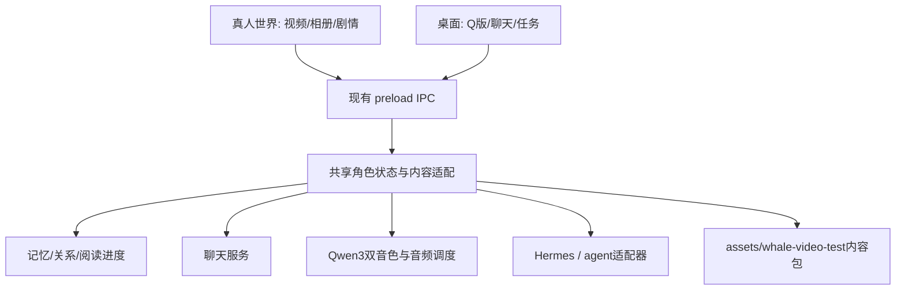

# 架构与主线决策

决定日期：2026-10-30。依据用户本次统一项目要求及最新双世界方向。

## 主线选择

| 工程 | 已有成果 | 主要成本 | 决定 |
|---|---|---|---|
| Electron MALFOY-ENGINE | 壁纸/world/desktop 三态、穿透、漫游、双音色、记忆/画像、Hermes 接口 | 鲸鱼内容适配、配置与隔离、发布整理 | 后续集成主线 |
| Swift PetDesk | 视频状态链、聊天/TTS、相册、图文剧、歌曲和回归检查 | 作为双世界主线还需迁入另一边的窗口/服务能力 | 保留迁移来源与回归基线 |
| 同时维护两个产品 | 短期减少迁移 | 记忆、人格、能力和文档持续分叉 | 不采用 |

旧决策称“Swift 没有聊天、没有 TTS”不属实。本次依据是双世界已有实现和迁移成本，不是废弃 Swift 的成果。逐项适配，不做一次性全量重写。

## 代码地图

| 位置 | 当前职责与后续处理 |
|---|---|
| MALFOY-ENGINE/main.js | 窗口、聊天/语音、记忆、工具进程、IPC；先配置和隔离，再按需要拆分 |
| MALFOY-ENGINE/preload.js | malfoyHost 白名单桥接，先兼容既有调用 |
| MALFOY-ENGINE/web/live2d/world.html | 两态共用舞台，真人视频、Q 版漫游/表情/过渡；在此继续接内容入口 |
| MALFOY-ENGINE/web/live2d/world-video.js | 原 PetDesk 模式适配、解码就绪切换、循环边界触摸、闲置与可见性 |
| MALFOY-ENGINE/web/live2d/composer.html/js | 独立悬浮打字/录音草稿窗口；只显示回复，舞台唯一播音 |
| MALFOY-ENGINE/lib/window-policy.js | 小窗/悬浮入口的工作区几何，纯逻辑便于检查 |
| MALFOY-ENGINE/lib/content-pages.js、gallery.js、affection.js | 当前相册/图文剧情、共享关系与窗口 IPC；源 pack 经 prepare-gallery-content.py 派生到运行目录 |
| MALFOY-ENGINE/web/data.js | persona 与双音色，也残留旧场景/剧情数据；需收口身份并适配鲸鱼 pack |
| MALFOY-ENGINE/web/index.html、app.js | 旧相册/剧情/好感面板，当前主窗口未加载，作为参考 |
| Sources/PetDesk/PetController.swift、Stage.swift | Swift 行为/视频状态机，迁移行为基准，回归修复沿用原结构 |
| PetPack.swift、PetPanels.swift、PetSongPlayer.swift | 内容结构、相册、图文剧、歌曲歌词，复用数据与行为 |
| Sources/CompanionCore/ | Swift 存储与模型接口，不是 Electron 已共享的库 |
| scripts/project.sh、project_audit.py | 统一工程命令与只读盘点，以 project.json 路由 |

## 目标职责（尚未全部实现）

以上是现有工程内的职责划分，不要求立即按框重构成独立服务。

## 共享状态契约

- 目标角色 ID 为 `lan`；DW-02 已统一两形态的身份提示、会话与 voiceProfile。旧包名/默认文案仍有“深蓝”等残留，命名统一单独处理，不把共享身份写成尚未实现。
- DW-02 已将会话归主进程；独立 composer 已消费 character:session，提交不再带旧 renderer 历史。
- 一份记忆、关系、阅读进度和任务集合；切换不生成第二画像或重复任务。
- 延续 JSON/JSONL，做版本与原子写入；无实际需要不引入向量库或新数据库。

## 内容契约

- 既有真源是 assets/whale-video-test/character.json 与 pack.json，新主线通过适配器消费，不手抄另一套内容。
- 保留 album、clips（image/file/text/duration）、chapters（flow/choices）、songs（file/lyrics）的 ID 与相对路径。
- 按引用清单打包，资源缺失要报告和降级，不静默过滤。
- ProRes 4444 是 Swift 播放素材，不能假定浏览器同样支持；Web 派生文件新命名、登记映射、保留原片。
- 床上睡眠是整场景，不按透明角色抠像；目前无躺下/起身过渡。

## 音频与任务契约

- world 清冷、desktop 活泼；实际 engine 命中 Qwen3 才能报 Qwen3 通过。
- 待处理语音绑定发起时的 profile，新请求使用当前形态，避免异步切换拿错音色。
- 聊天、歌曲、读书已接可停止的音频调度；DW-05 继续验收真实连续操作、形态切换与听感，不把源码仲裁当成全部实测通过。
- 工作复用 companion:work / Hermes，目标状态 queued/running/completed/failed/cancelled，返回实际产物或明确失败。
- 超时不等于子进程已终止；取消与晚到结果必须有验证。
- 文件删除、外发等不可逆动作按用户授权执行，不把模型文本直接扩成无边界 shell。

## 当前打包边界

project.sh build 调 build-companion.sh，依赖 SmartCompanion.app 母体，适用于本机。已接临时构建、严格签名及素材来源/字节校验后备份替换、四种真人视频派生素材、相册/图文剧情与歌曲入口。2026-10-31 FIX-01 收尾：并行工作已将源/运行派生/包的相册数量更新为 26/26/26；最新剧情源码与包仍不一致，内容测试契约与新修复打包验收见 [修复规划](REPAIR-PLAN.md)。独立依赖声明与发布由 DW-08 收口。

窗口决定及当前边界见 [视频与悬浮对话交付](updates/2026-10-30-DW-03-video-float.md)。旧目录名与服务相对位置保留。
