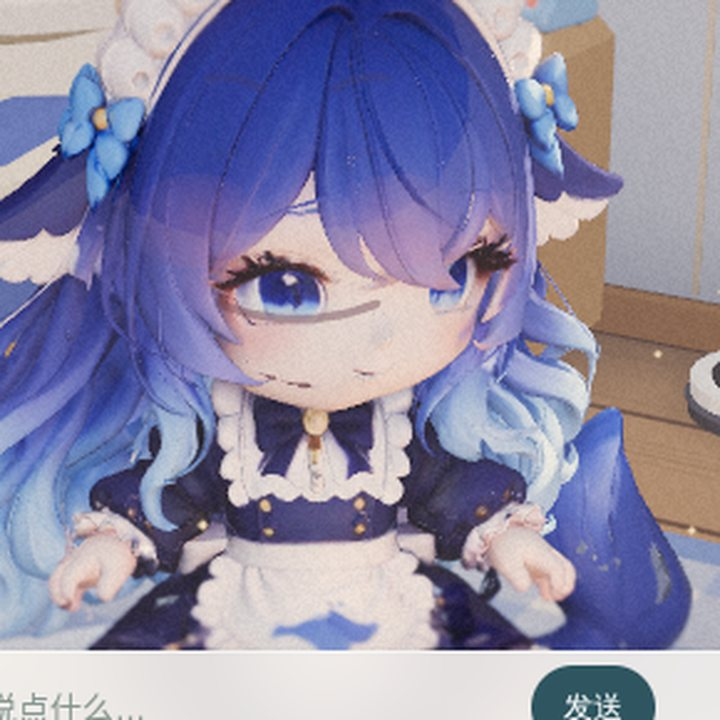

# WORLD-FACE-01 · 口型与表情（2026-11-01）

## 需求

> 「角色可以互动说话，模型表情和说话要同步有动画。」

拆成三条硬要求：她说话时**嘴要动**、动的**节奏要跟着这句话**、表情要**跟着语气变**。

## 第一条就撞墙：这个模型没有脸

先查了资产，不是猜的：

```
info.rigVersion = 15, rigged = true, localHeight = .78
骨骼表（lan-model.js:55-68）：lan-root / lan-spine / lan-head / lan-skirt / 四肢
没有 morph target，没有 jaw / brow / eye 骨骼，没有 blendshape 通道。
```

一个 skinned GLB，一个 head 骨骼，就这样。想让她张嘴只有三条路：

| 方案 | 代价 | 结论 |
|---|---|---|
| 重新绑定模型加面部骨骼 | 要 DCC、要权重、要重导 GLB | 不是改代码，是重做资产 |
| 顶点着色器按 UV 区域扭嘴 | 得知道脸在 UV 上的哪一块，试错成本高，一错就是整张脸 | 放弃 |
| 在画面上叠一层「墨线脸」 | 只有 2D，可以随时关掉，不碰模型 | **选这个** |

所以 `web/moli-room/lan-face.js` 是一层独立的 2D canvas，铺在 3D 画面上方：

- 每帧把 `lan-head` 骨骼的世界坐标投影到屏幕，得到锚点；
- 从锚点沿镜头右向量走一米再投影一次，得到「每米多少像素」，**所有尺寸都是世界米**，
  缩放和机位无关，凑近看和站远看是同一张嘴；
- 嘴、腮红、眉、笑眼全部按锚点的相对位置画，`globalCompositeOperation='multiply'`
  让墨色渗进皮肤，而不是糊一层贴纸。

`lan-head` 骨骼其实落在**眼睛高度**（不是颈根），所以嘴在锚点**下方** 8mm，
眼线只比锚点高 9cm。这是拿 `?face=1` 的标尺对着她的真脸量出来的，写进了
`TUNE` 的注释里；换模型必须重量一次。

## 口型怎么跟声音同步

三条驱动，按可用性叠加：

1. **真实波形**：`CompanionPlayback` 播语音用的是同一个 `<audio>`。第一次真实点击后
   把它接到 `AnalyserNode`，取 RMS 包络 —— 嘴跟着真实声音走。
2. **文字时间轴**：中文一个字一个音节，元音决定开口度（a 最大 1.0，i/u 只有 0.44），
   标点算停顿（句号 2.6 个音节时长）。同一个字永远是同一个口型（码位取模，稳定不乱跳）。
3. **真实时长**：拿到 `audio.duration` 就把整条时间轴缩放到它，句尾不会嘴还没合上
   声音就没了。

每帧取 `max(时间轴 × 0.92, 包络)`：有声音时波形说了算，纯文字时时间轴顶着。
起音 20ms、落音 90ms 的不对称平滑，避免嘴黏在上一帧。

工程上有个坑值得记：`createMediaElementSource` 一旦建在 **suspended** 的
AudioContext 上，`<audio>` 会变成哑的 —— 「加了口型」的代价会变成「她不再说话」。
所以接入点挂在第一次 `pointerdown` / `keydown`，并且 `resume()` 失败就
`unroute()` 把元素直接接回 `destination`。

## 表情

状态机，键是 `curve / brow / blush / eyeSmile / open`，五条插值通道，
`emote(name, ms)` 换目标，420ms 三次平滑：

| 情绪 | 触发 | 表现 |
|---|---|---|
| neutral | 默认 | 微弯的嘴线，几乎没有腮红 |
| happy | ！/好耶/开心/喜欢 | 大弯嘴、眉梢上扬、腮红 |
| shy | 害羞/脸红/唔 | 嘴角小、腮红最浓、眉压低 |
| sad | 对不起/难过/呜 | 嘴角向下、眉向上皱 |
| surprise | 诶/真的吗/什么 | 眉挑高、嘴张开 |
| think | 文本里有问号 / 正在等回复 | 眉微皱，等 `setBusy(true)` 时进 |
| sleepy | 预留（夜里闲置） | 眯眼 |

情绪还会**自己**从回复文本里读，不需要宿主额外传字段。

## 验收

新增 `tools/face-probe.py`，在真实房间页里跑（不是 mock 场景）：

```
python3 tools/face-probe.py --keep /tmp/face
```

一次加载内做 11 项断言，全绿：

```
== 锚点 ==   已加载 / 锚点可见(ok:103) / 在画面内(456,289) / ppm=117
== 说话 ==   35 音节 7.31s / 峰值 0.65 / 有起伏(min .00 max .36)
== 收口 ==   停下后 2s 内归零 / speaking 状态清零
== 情绪 ==   shy 腮红 .72 vs neutral .06 / 情绪被记住 / 无脚本错误
```

为什么不用像素比对：这屋子的动态颗粒和窗外海浪每帧都在动（同一个结论先在
`tools/room-fx-probe.py` 里吃过一次亏）。口型有确切数值状态，直接读
`__lanFace.debug` 比截图判读准。截图只作人工参考。

## 附图

特写机位（`?cam=0.55,0.95,0.35,0.05,0.62,-0.5`），说话中与害羞：




默认机位下她只有 90px 高，嘴是 8px 的一条线——这是分辨率的物理下限，
不是参数没调好。要看口型必须凑近。

## 已知限制

- **没有眨眼**。程序化角色有 `blink`，GLB 没有眼睑几何。硬画眼睑会盖住她原本画得
  很好的眼睛，所以暂时不做；要做只能走贴图替换（改 GLB 材质）而不是加法。
- 特写下嘴宽约 27px、写实比例会小到看不见，所以嘴宽按脸宽的 0.33 夸张了。
  远机位（默认视角）她只有 90px 高，嘴是 8px 的一条线——这是分辨率的物理下限，
  不是参数没调好。
- 说话时的身体动作（点头、手势）仍在 `lan-model.js` 的 `pose()` 里，
  本次没有动它一个常数。
