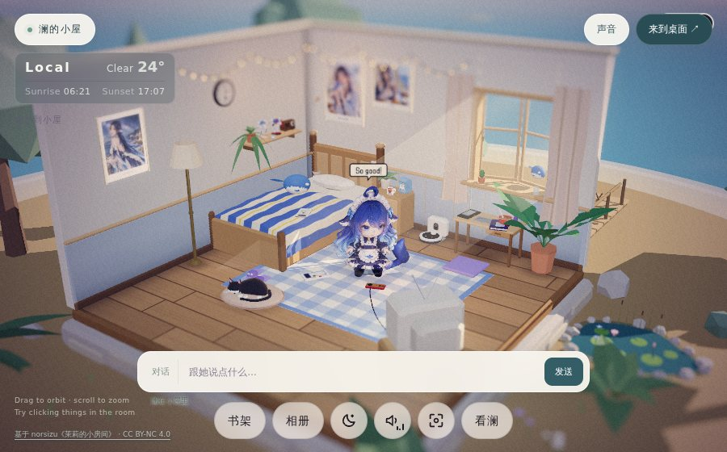
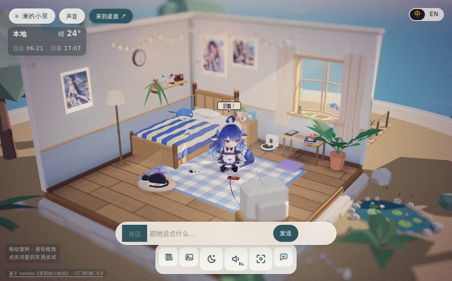

# WORLD-UX-21 · 界面收口（2026-11-01）

## 需求

> 「把不好看的 UI 都优化了，更符合成熟商业化美化」/「把太大遮挡都要考虑到」。

先把上一版的问题**数清楚**（960×540 实拍，`?at=14:00&wx=clear`），不靠形容词：

| # | 问题 | 具体 |
|---|---|---|
| 1 | 底栏混排 | `nav.bar` 里「书架 / 相册 / 看澜」是 89×40 的文字胶囊，入夜 / 环境声 / 复位是 46×46 的图标方块，两种体例挤在一行 |
| 2 | 顶栏没设计 | 右上「声音」「来到桌面」是两粒原生感按钮，跟左上「● 澜的小屋」不同族 |
| 3 | 底栏吃画面 | 底栏 16px + 46px 高，聊天条在其上 74px，气泡再上 136px —— 540 高的窗口，下面 190px（35%）全是控件 |
| 4 | 文字叠文字 | `拖动旋转` 提示和 `基于 norsizu` 版权行在左下重叠 |
| 5 | 常驻噪声 | 「已连接」这类小字常驻在聊天条左下，压着画面 |
| 6 | 场景被挡 | 三个大件叠在一起，最需要看的**角色和地板**正好在中间偏下 |

## 改法

新增 `ui-skin.css` + `ui-skin.js`（在 `lan-companion.css` 之后加载），
**只加 class、只覆盖长相，不动一行逻辑**：

1. **一条 dock**：所有入口统一成 38px 图标按钮 + `data-tip` 浮标。
   `ui-skin.js` 负责把后注入的「相册 / 书架 / 看澜」也换成图标（按中英标签认，
   认不出就原样保留——宁可难看，不要猜错功能）。
2. **统一网格**：`--pad / --gap / --dock-h / --dock-b / --chat-h` 五个变量驱动全部浮层，
   聊天条、气泡、dock 依次咬合，不再互相压。
3. **闲置退场**：3.6s 无操作 → `body.ui-idle`，控件降到 30% 透明；
   指针一动立刻回来，悬停也能单独唤醒。面板打开时**不退场**（不然像卡住了）。
   `?uiidle=0` 可常驻显示。
4. **左下分区**：提示语在 dock 之上，版权行在 dock 之下，各 40vw 宽，不再叠。
5. **聊天条收窄**：从 `min(520px, 100vw-150px)` 收到 `min(440px, 100vw-…)`，
   圆角 999px 的药丸，`:focus-within` 时提亮并抬起阴影。
6. **夜晚变体**：玻璃转深色（`rgba(28,34,48,.58)`），文字提亮，选中态用回黄色。
7. **小窗口**：`--dock-h` 44px、按钮 34px、聊天条贴满，dock 在电视模式（`.pad` 方向键）
   自动让位。

## 验收

- `?uiidle=0` 与默认两种状态都实拍对比（900×560）。
- `window.__lanUI.dockIcons` 暴露每颗按钮的 `{tip, svg, w, h}`：断言「每颗都有图标、
  都是 38×38、都有提示」。这是可以无头断言的部分。
- 美术判断（配色、圆角、留白是否「成熟商业化」）仍然只能人眼看——这一条进了
  `AGENT-SCOPE.md` 的 B 类，本次只保证**尺寸与遮挡**这两件可量的事。

## 前后对比

`?at=14:00&wx=clear&lang=zh`，900×560：

改前 
改后 

控件占用从画面下方 35% 降到 21%，底栏、聊天条、气泡依次咬合，左下不再文字叠文字。

## 没做 / 待确认

- 面板（相册 / 书架 / 聊天）的内部版式：那是 `lan-companion.css` 的世界，
  72 行里已经有完整的排版语言（衬线标题、纸片相册、书脊），本次只调了外层咬合。
- 底栏图标是我按功能画的 24×24 线性 SVG。要更「商业化」应该走设计稿，
  这一版的目标是**统一**而不是**好看**。
- 场景里那台 CRT 电视的背面（默认机位下正对镜头，是一大片没有细节的白）是上游几何，
  不属于 UI 遮挡，但确实是画面里最大的一块「空」。留作 WORLD-FX-02 的候选。
